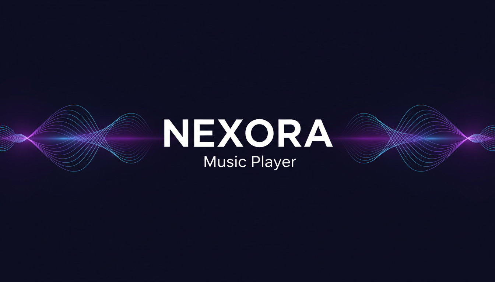

<div align="center">



<h1>Nexora</h1>

**Simple Android YouTube Music client with Material UI, Liquid Glass, Bit-Perfect playback, Automix, Lossless addons, Musicolet-style equalizer & advanced audiophile features.**

<br/>

<p align="center">
  <a href="https://github.com/mdsarimsd-ui/nexora-music-player/blob/main/LICENSE"></a>
  
  
  
  
</p>

</div>

---

## Support the developer

Nexora is free and open source. If it earns its place on your home screen, you can support development over UPI: **9112270039@fam** (Sarim Siddiqui).

## Overview

Nexora is a fast, native YouTube Music client for Android that looks great and sounds even better. Built with Material 3 Expressive and Liquid Glass UI, it gives you a clean, fluid design that adapts to your music.

For audio lovers, Nexora packs Bit-Perfect USB DAC output, Lossless FLAC addon support, a Musicolet-style 15-band equalizer with Bass Boost and 3D Surround, AutoEQ headphone presets with parametric EQ, smooth Automix transitions, Spotify Canvas integration, and real-time synced lyrics, all in a lightweight app.

---

## Features

The list below separates what works reliably today from what is still being tuned, what needs specific hardware, and what is only planned. Everything ships in the same APK; nothing here is behind a paid tier.

### Stable

Work on every supported device (Android 7.0+) and have been in releases for a while.

- Stream any track or video from YouTube Music
- Background playback with lockscreen and Android Auto controls
- Download and cache for offline listening; high-res audio downloads with embedded tags and `.lrc` lyrics
- Full library management, offline cached library, queue management and local/cloud playlists with custom reordering
- Search songs, albums, artists, videos and playlists; personalized quick picks, mood radios and genre discovery
- Live millisecond-synchronized lyrics (LRCLIB plus several lyrics providers)
- Lyrics romanization for non-Latin scripts and multi-language lyrics translation
- Export and share lyrics as aesthetic quote cards
- Musicolet-style 15-band equalizer with Bass Boost and 3D Surround, classic EQ presets, AutoEQ headphone presets and parametric EQ (app-level DSP, independent of device effect support)
- Audio normalization (ReplayGain / LUFS) and real-time tempo and pitch control
- Material 3 Expressive and Liquid Glass UI, Dynamic Monet theming plus 19 preset color palettes, Light / Dark / Pure Black (AMOLED) / Dynamic modes
- Interactive home screen widgets and fluid tactile haptics
- Listen together (Jam) with friends in real time, with shareable invite links
- Built-in Last.fm scrobbler with background tracking (requires signing in to Last.fm)
- Discord Rich Presence with live album art (requires Discord installed on the device)
- Spotify Integration: account login, Liked Songs sync and deep links
- Import public playlists from Spotify and Apple Music
- YouTube Music account login and bidirectional sync
- Custom audio tag editing and cover art selection
- Backup and restore of settings, playlists and equalizer presets (one JSON file; song files are not included)
- In-app update checker against this repository's GitHub releases

### Experimental

Shipped and usable, but still being tuned and may change between releases.

- 8D / 16D spatial audio with a per-song toggle on the player screen (the stereo envelope is still being tuned to avoid harshness; recent releases adjusted the one-ear fix and the strip behavior)
- Smart Automix transitions and smooth crossfade (the deck-blend engine keeps getting refined)
- Spotify Canvas and animated video backgrounds (Apple Music and Tidal); depends on third-party endpoints that may go down
- Camera-cutout media pill (off by default, enable in Settings); turned off on devices where the cutout does not report properly
- Ask AI: a Gemini-powered assistant on the current song screen; optional, needs your own API key (see "API keys" below)

### Device-dependent

Need specific hardware to do anything; on other devices they stay unavailable or fall back.

- Bit-Perfect USB DAC output: exclusive-mode direct hardware bypass; needs a USB audio device attached (OTG)
- Lossless FLAC addon support up to 24-bit Hi-Res: needs the addon pack and device codec support
- Real-time backdrop refraction shaders: run on any device with a GPU, but render cost scales with device performance

### Planned

Not in any release yet. See the Roadmap below for detail.

- Real AdMob ad units (the capped-ads scaffold ships with Google's public test IDs only; see "Optional ads")
- Self-hosted Jam sync server (rooms currently run on the upstream project's free server)
- Per-device equalizer memory (different EQ for headphones vs speaker)
- Desktop builds (the in-app desktop entry is hidden until real builds exist in Releases)

---

## Optional ads

Nexora is fully usable with no ads and no account. The app ships a capped-ads scaffold as an opt-in way to support development:

- Off by default. Nothing loads unless the user enables ads in Settings.
- When enabled, at most 3 interstitial ads per day, at least 90 minutes apart; the rest of the day stays completely ad-free.
- The UPI donation prompt is separate and unchanged.
- Current builds embed Google's public test ad-unit IDs only, so they serve test ads and generate no revenue. Real AdMob ad units are deferred until the project has an established user base; replacing the constants requires an AdMob publisher account.
- The Google Mobile Ads SDK is bundled for this feature. It initializes only when ads are enabled; with ads off it stays idle.

## API keys

The app ships with no API keys and no bundled credentials.

- **Ask AI (Gemini):** optional. Disabled by default; enabling it requires the user's own Google AI Studio API key, entered in Settings. The key is stored only on the device (local preferences) and is never included in backups, logs or crash data (the app does not ship a crash reporter). When used, requests go directly from the device to Google's Generative Language API.
- Every other feature (streaming, lyrics, Jam, scrobbling, imports) works without any key.

## External services and privacy

The app contains no analytics, no crash-reporting SDK and no tracking. There are no accounts to create. What it does talk to, and why:

| Service | When | What is sent |
|:---|:---|:---|
| YouTube Music (`music.youtube.com`, `youtube.com`) | Streaming, search, discovery, account sync | Standard API requests for the media you browse or play, plus your YouTube Music account tokens if you sign in |
| Lyrics providers (LRCLIB, Bini/BetterLyrics, Megalobiz, SimpMusic, LyricsPlus and friends) | When lyrics are shown or cached | The track title and artist, plus a generic User-Agent. Nothing about you |
| Last.fm | Only if you log in to scrobble | Track plays, via the official Last.fm API |
| Spotify | Only if you log in or import | Account tokens you grant, playlist lookups for imports and Canvas art |
| Apple Music | Only when importing a playlist | Public playlist lookups |
| Jam sync server (`wss://jam.clashgram.org/ws`, changeable in Settings) | Only in a Jam room | Room code and playback sync data needed to keep every participant on the same track |
| GitHub releases API | Update check (on app open) | Nothing identifying; a plain HTTP GET |

Stored locally on the device: your library cache, preferences, download history and search history. Audio is never uploaded anywhere. Backups are manual, one JSON file, and contain playlists, settings and EQ presets only, never song files and never API keys.

## Getting Started

### Installation

| Channel | Source | Compatibility |
|:---|:---|:---|
| **Stable Release** | [GitHub Releases](https://github.com/mdsarimsd-ui/nexora-music-player/releases) | Recommended for all users • Android 7.0+ (API 24+) |
| **Nightly Builds** | [GitHub Actions](https://github.com/mdsarimsd-ui/nexora-music-player/actions) | Latest automated builds with bleeding-edge features |

### Quick Setup

1. Install the APK on your Android device.
2. *(Optional)* Navigate to **Settings → Audio** to configure:
   - **Equalizer:** Open the 15-band equalizer for Bass Boost, 3D Surround and presets.
   - **Bit-Perfect Output:** Enable exclusive USB DAC mode for bit-perfect audio.
   - **AutoEQ Presets:** Search for your headphones/IEMs to apply calibrated parametric EQ curves.
   - **Lossless Addons:** Enable the modular addon service for 24-bit Hi-Res FLAC playback.
3. Start streaming music, listening to customized radios, and enjoying synced lyrics!

---

## Building from Source

### Prerequisites
- **JDK:** OpenJDK 17 or higher
- **Android SDK:** API Level 34+ with CMake & Android NDK installed (for native audio C++ engine & USB driver)

### Build Instructions

```bash
# Clone the repository
git clone https://github.com/mdsarimsd-ui/nexora-music-player.git
cd nexora-music-player

# Build the release APK
./gradlew assembleRelease

# The generated APK will be at:
# app/build/outputs/apk/release/app-release-unsigned.apk
```

> [!TIP]
> For local development and debugging, run `./gradlew assembleDebug` or install directly to a connected device via `./gradlew installDebug`.

---

## Roadmap

- Per-device equalizer memory (different EQ for headphones vs speaker)
- Crossfade slider refinements
- Playback speed and pitch enhancements
- Self-hosted Jam sync server
- Real AdMob ad units (deferred until the project has an established user base)

## Disclaimer

This project is not affiliated with YouTube, Google, Spotify, or Musicolet. Streaming from YouTube Music may violate their Terms of Service in some regions; use at your own discretion. The app is distributed as an installable APK and is not published on Google Play.

---

## License

Nexora is licensed under the [GNU General Public License v3.0](LICENSE).

### Attribution and upstream

Nexora is a fork of [LastWave](https://github.com/clash-projects/lastwave) by ajisth69, originally licensed under GPL-3.0. Under GPL-3.0 the original copyright and license notices are preserved: this repository keeps the upstream copyright headers in source files, and all modifications and rebranding are likewise released under GPL-3.0.

A note on names in the source tree: the historical `com.lastwave.app` package namespace, the `lastwave_audio` native module, the `lastwave://` deep-link scheme and the old preference/database file names are intentionally kept. Renaming them would break the Java/JNI symbol contract and deep links that existing installs and shared Jam invite links depend on, for no user-visible benefit: the installed package is `com.nexora.app`, the app name and every user-facing string say Nexora, and the update channel and lyrics User-Agent point to this repository. These names are internal identifiers, nothing more.

